# Al-Quran & Halal Web Shield — Browser Extension Implementation Plan (Manifest V3)

> [!IMPORTANT]
> This browser extension provides an all-in-one Islamic companion for **Google Chrome, Microsoft Edge, Brave, and Opera**. It runs **100% free with zero third-party subscriptions**, pairing a complete Islamic daily suite (Prayer, Ayah, Hadith, Tasbih, Noor AI) with a powerful **Halal Web Guard (Adult Blocker, Reels/Shorts Blocker, Ad Blocker, SafeSearch Enforcer)**.

---

## 🏛️ Extension Architecture (Manifest V3)

```mermaid
graph TD
    Ext["Al-Quran & Halal Web Shield Extension (Manifest V3)"]
    Ext --> Popup["Toolbar Popup UI (extension/popup)"]
    Ext --> Worker["Background Service Worker (extension/background)"]
    Ext --> Content["Content Scripts Engine (extension/content-scripts)"]
    Ext --> DNR["Declarative Net Request Engine (extension/rules)"]

    Popup --> P1["Prayer Times & Live Countdown"]
    Popup --> P2["Daily Ayah & Hadith with Audio"]
    Popup --> P3["Digital Tasbih with Presets"]
    Popup --> P4["Noor AI Islamic Assistant"]
    Popup --> P5["Halal Shield Controls & Live Blocked Stats"]

    Worker --> W1["Chrome Alarms (Prayer Time Tracking)"]
    Worker --> W2["Desktop Notifications & Adhan Audio"]
    Worker --> W3["Context Menu ('Search in Al-Quran')"]
    Worker --> W4["Dynamic Badge Counter (Blocked items count)"]

    Content --> C1["YouTube Shorts Blocker & Auto-Redirector"]
    Content --> C2["Facebook Reels Remover (Feeds & Watch Tray)"]
    Content --> C3["Instagram Reels & Explore Filter"]
    Content --> C4["DOM MutationObserver for Infinite Scroll Protection"]

    DNR --> D1["Adult & Explicit Domain Blocker -> Quran Redirect (blocked.html)"]
    DNR --> D2["Web Ad & Tracker Filter (Ad Networks & Popups)"]
    DNR --> D3["SafeSearch Enforcer (Google, Bing, DuckDuckGo)"]
```

---

## 🌟 Complete Feature Parity & Capabilities Matrix

| Feature Area | Specific Capabilities in Extension |
| :--- | :--- |
| **🎬 Reels & Shorts Blocker** | • **YouTube:** Hides left sidebar "Shorts" button & home shelves; auto-redirects `/shorts/{id}` to standard player (`/watch?v={id}`) • **Facebook:** Removes Reels tray from News Feed & Watch tab • **Instagram:** Removes Reels icon from sidebar & hides Reels video grids • **TikTok:** One-click complete domain block toggle |
| **🛡️ Adult & Explicit Content Blocker** | • Native Chrome `declarativeNetRequest` engine blocking known explicit domains • Zero battery/performance impact • Auto-redirects blocked requests to serene Islamic reminder page (`blocked.html`) with Surah An-Nur 24:30 |
| **🚫 Web Ad & Tracker Blocker** | • Blocks intrusive ad network hosts, popup scripts, and gambling banner networks • Cleans up web reading experience |
| **🔍 Forced SafeSearch** | • Locks Google Search, Bing, and DuckDuckGo into strict SafeSearch mode (`safe=active`) across regular and incognito tabs |
| **🕌 Prayer Times & Waqt Countdown** | • GPS/IP-based live prayer times for Fajr, Dhuhr, Asr, Maghrib, Isha, and Tahajjud • Live countdown timer to the next prayer waqt • Background audio Adhan alert option |
| **📖 Daily Noor (Ayah & Hadith)** | • Daily curated Quran Ayah with Arabic text, Bengali translation, and recitation audio • Daily Sahih Hadith reflection |
| **📿 Digital Tasbih** | • Smooth tap counter with presets (SubhanAllah, Alhamdulillah, Allahu Akbar, Astaghfirullah) • Reset and target count tracker |
| **💬 Noor AI Assistant** | • Integrated Islamic Q&A chat right inside the browser toolbar popup • Instant answers with Quranic references |
| **🖱️ Context Menu Search** | • Highlight any word or verse on any webpage -> Right-click -> "Search in Al-Quran" |
| **📊 Live Statistics** | • Real-time counter of total adult sites blocked, reels hidden, and ads prevented |

---

## 📅 Detailed Phase-by-Phase Roadmap

### 📌 Phase 1: Manifest V3 Foundation & Core Scaffolding
- **Goal:** Set up the standard Manifest V3 structure in `extension/` with permissions, icons, and configuration.
- **Tasks:**
  1. Create `extension/manifest.json` with permissions:
     `declarativeNetRequest`, `declarativeNetRequestFeedback`, `storage`, `alarms`, `notifications`, `contextMenus`, `scripting`.
  2. Configure host permissions for target media platforms (`*://*.youtube.com/*`, `*://*.facebook.com/*`, `*://*.instagram.com/*`, `*://*.tiktok.com/*`).
  3. Set up emerald Islamic icons (16px, 32px, 48px, 128px) in `extension/assets/icons/`.
  4. Create `extension/package.json` with build and packaging scripts.

---

### 📌 Phase 2: Reels & Shorts Content Script Engine
- **Goal:** Eliminate short-form dopamine loops on YouTube, Facebook, and Instagram.
- **Tasks:**
  1. Create `extension/content-scripts/reels-blocker.js` and `reels-blocker.css`:
     - **YouTube:** 
       - Intercept URL change to `/shorts/*` and rewrite history/URL to `/watch?v={id}` without reload.
       - CSS rules hiding `ytd-rich-shelf-renderer[is-shorts]`, `ytd-reel-shelf-renderer`, and `ytd-guide-entry-renderer a[title="Shorts"]`.
     - **Facebook:**
       - MutationObserver identifying and removing Reels carousels and "Reels and short videos" feed units.
     - **Instagram:**
       - Hide Reels navigation icon (`a[href="/reels/"]`) and Explore video feed.
  2. Sync state with `chrome.storage.local` so users can toggle Reels blocking ON or OFF per platform in settings.

---

### 📌 Phase 3: Declarative Net Request (DNR) Rulesets & Islamic Redirect
- **Goal:** High-performance, low-level blocking of adult domains, gambling, and forced SafeSearch.
- **Tasks:**
  1. Create `extension/rules/adult-rules.json`:
     - Fast regex/urlFilter rules blocking adult networks and gambling domains.
     - Redirect action pointing to `extension/blocked/blocked.html`.
  2. Create `extension/rules/safesearch-rules.json`:
     - Transform action appending `safe=active` to Google Search (`google.com/search*`) and Bing (`bing.com/search*`).
  3. Create `extension/rules/ad-rules.json`:
     - Block common intrusive pop-up scripts, ad-servers, and tracking scripts.
  4. Build `extension/blocked/blocked.html`:
     - Serene Islamic visual theme with Arabic verse (*Surah An-Nur 24:30*), Bengali/English translation, and a button to return to Al-Quran.

---

### 📌 Phase 4: Background Service Worker Engine
- **Goal:** Manage background timers, notifications, context menu search, and badge counters.
- **Tasks:**
  1. Create `extension/background/service-worker.js`:
     - Periodic `chrome.alarms` calculating accurate prayer times based on stored coordinates.
     - Dispatch native Chrome desktop notifications when prayer time arrives.
     - Register `chrome.contextMenus` for "Search in Al-Quran".
     - Maintain and update toolbar badge text (e.g. prayer countdown or blocked items count).

---

### 📌 Phase 5: Toolbar Popup UI (All-in-One Islamic Suite)
- **Goal:** Build an elegant 400x580px popup containing all daily Islamic utilities and blocker controls.
- **Tasks:**
  1. Create `extension/popup/popup.html`, `popup.css`, `popup.js`:
     - **Tab 1: 🕌 Prayer Times:** Current Waqt badge, live countdown, full daily timetable.
     - **Tab 2: 📖 Daily Noor:** Daily Ayah with audio player and Hadith of the day.
     - **Tab 3: 📿 Digital Tasbih:** Tap counter with Dhikr presets and haptic feedback.
     - **Tab 4: 💬 Noor AI:** Interactive Q&A chat assistant directly in popup.
     - **Tab 5: 🛡️ Halal Shield:** Master toggle, category switches (Reels, Adult, Ads, SafeSearch), and live block statistics.

---

### 📌 Phase 6: Storage Synchronization & Quick Settings
- **Goal:** Persist user preferences and sync settings seamlessly.
- **Tasks:**
  1. Use `chrome.storage.local` with fallback to `chrome.storage.sync`.
  2. Store language (Bangla/English), calculation method, blocker toggles, and Tasbih counts.
  3. Direct shortcut button to open the full Al-Quran web app.

---

### 📌 Phase 7: Testing, Unpacked Verification & Distribution
- **Goal:** Ensure flawless operation across Chrome and Edge and prepare Web Store zip package.
- **Tasks:**
  1. Load unpacked in Chrome via `chrome://extensions` with Developer Mode.
  2. Test YouTube Shorts redirection and Facebook/Instagram Reels removal.
  3. Test adult domain redirection to `blocked.html`.
  4. Build automated zip script (`npm run package:zip`) producing `al-quran-extension-v1.0.0.zip` ready for Chrome Web Store and Edge Add-ons dashboard.
