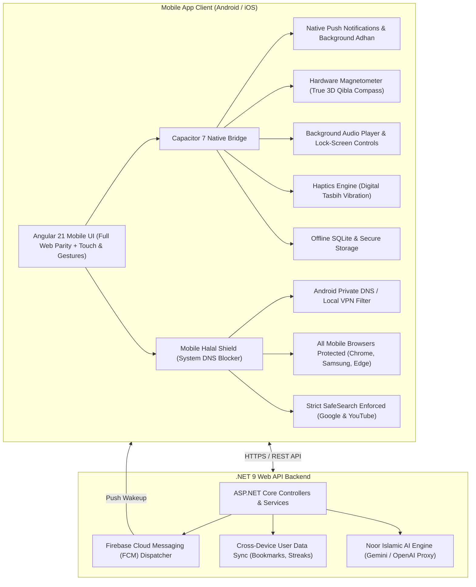

# Al-Quran Mobile App — Complete Implementation Plan (Capacitor + Angular + .NET)

> [!IMPORTANT]
> This document details the end-to-end roadmap for building the official **Al-Quran Mobile Application** for **Android (APK & Google Play Store)** and **iOS (App Store)**. It guarantees **100% feature parity with the web version** while incorporating a dedicated **Mobile Halal Guard & System Blocker**. It runs on **Capacitor 7** alongside our modern **Angular 21** frontend and **.NET 9 Web API** backend.

---

## 🏛️ System Architecture

---

## 🌟 100% Web Feature Parity Guarantee

Every single feature present in the web and desktop versions is fully preserved and optimized for mobile:

| Web Feature | Mobile Implementation Status |
| :--- | :--- |
| **Complete 114 Surahs** | Included (Arabic text, Bangla & English translation, word-by-word) |
| **All 30 Juz / Paras** | Included with instant Juz reader |
| **Hadith Library** | Included (Bukhari, Muslim, Tirmidhi, Abu Dawood with search & filters) |
| **Asma-ul-Husna (99 Names)** | Included with Arabic audio recitation and Bangla/English meanings |
| **Ruqyah Shariah** | Included (Full Ruqyah audio tracks & category-based reading) |
| **Islamic Hijri Calendar** | Included (Moon phase, Islamic holidays, Fasting dates) |
| **Prayer Times & Waqt Countdown** | Included (GPS-based accurate calculation for any global location) |
| **3D Qibla Compass** | Included (Powered by native phone hardware magnetometer) |
| **Nearby Mosques** | Included (Interactive OpenStreetMap with GPS route directions) |
| **Digital Tasbih** | Included with physical haptic vibration feedback on every tap |
| **Noor AI Assistant** | Included (Islamic Q&A chat with rate-limit and safety guardrails) |
| **Bookmarks & Last Read** | Included (Persisted locally and synced with .NET cloud backend) |
| **Daily Quran Tasks & Streaks** | Included with daily progress bar and goal tracking |
| **Continuous Audio Recitations** | Included with background playback and lock-screen media player |
| **Bilingual & Theme Support** | Included (Bangla/English toggle; Dark, Light, and Emerald themes) |
| **🛡️ Halal Blocker Shield** | **Included (System-wide mobile adult & ad blocking across all browsers)** |

---

## 📅 Detailed Phase-by-Phase Roadmap

### 📌 Phase 1: Environment & Project Foundation
- **Goal:** Set up Capacitor in the `mobile/` directory and establish the build pipeline from Angular.
- **Tasks:**
  1. Configure `mobile/package.json` with `@capacitor/core`, `@capacitor/android`, `@capacitor/ios`, and CLI tools.
  2. Create `mobile/capacitor.config.ts` targeting app ID `com.alquran.mobile` and web assets in `../frontend/dist/frontend/browser`.
  3. Set up deep linking schemes (`alquran://`) for Quran ayahs, Hadith, and Prayer notifications.
  4. Generate adaptive icons and 9-patch splash screens for Android (LDPI, MDPI, HDPI, XHDPI, XXHDPI, XXXHDPI) and iOS asset catalogs.

---

### 📌 Phase 2: Mobile-First UI/UX & Native Gestures
- **Goal:** Adapt the Angular UI to deliver a smooth, native app feel on mobile screens.
- **Tasks:**
  1. **Safe Area & Edge-to-Edge:** Handle mobile display notches, dynamic islands, and Android navigation bars using CSS `env(safe-area-inset-top)` and `env(safe-area-inset-bottom)`.
  2. **Touch Gestures:**
     - Swipe left/right between Surahs and Ayahs.
     - Pull-to-refresh on Prayer Times and Daily Hadith.
     - Long-press to bookmark, copy, or share Ayah cards.
  3. **Bottom Navigation Bar:** Optimize the 5 primary tabs for single-hand thumb navigation (Home, Quran, Hadith, Prayer, Bookmarks).
  4. **Smooth Transitions:** Native-like page transitions without flicker or white flashes.

---

### 📌 Phase 3: Hardware & Native Mobile Capabilities
- **Goal:** Integrate native device hardware APIs via Capacitor plugins.
- **Tasks:**
  1. **Background Audio & Lock-Screen Player (`@capacitor-community/media`):**
     - Continuous audio recitation playback even when the screen is locked or the app is minimized.
     - Lock-screen media notifications with play/pause, next/previous ayah controls, reciter name, and surah art.
  2. **Push Notifications & Automated Adhan (`@capacitor/local-notifications` + FCM):**
     - Precise prayer alarms scheduled using local device notifications.
     - Automatic Adhan audio playback at exact Waqt times even when offline.
  3. **Hardware Compass / Magnetometer (`@capacitor/motion`):**
     - Real-time 3D directional Qibla pointer pointing accurately toward the Holy Kaaba in Makkah.
  4. **Haptic Feedback (`@capacitor/haptics`):**
     - Satisfying physical vibration click on every digital Tasbih tap.
     - Success vibration on prayer goal completion.
  5. **Offline Storage & Caching (`@capacitor/preferences` + IndexDB/SQLite):**
     - 100% offline Quran Arabic text, Bengali translation, and Hadith data.

---

### 📌 Phase 4: Mobile Halal Guard & System Blocker Engine (NEW)
- **Goal:** Provide 100% free system-level content & ad blocking on Android and iOS devices.
- **Tasks:**
  1. **Android Private DNS (DoT / DoH) Integration:**
     - One-click configuration guide for Android 9+ Private DNS (`family.cloudflare-dns.com` or `dns.cleanbrowsing.org` or `dns-family.adguard.com`).
     - **Result:** Blocks 100% of adult websites, malicious links, and ads across **Chrome, Samsung Internet, Edge, Opera, and all mobile apps on the phone**.
  2. **Local Loopback VPN/DNS Service:**
     - Zero external server, on-device loopback DNS filter routing DNS requests to Cloudflare Family Filter (`1.1.1.3`).
     - 100% free, zero bandwidth cost, zero privacy tracking.
  3. **SafeSearch Enforcement:**
     - Automatically locks Google Search, Bing, and YouTube into strict SafeSearch on mobile browsers.
  4. **Mobile Shield Dashboard UI:**
     - Dedicated **`[ 🛡️ হালাল শিল্ড ]`** card in mobile Settings and Top Bar.
     - Live diagnostic tool: "সুরক্ষা যাচাই করুন (Verify Protection)" checking if DNS blocking is active.
     - Clear status badge: `🟢 সুরক্ষিত (Protected)` vs `⚪ নিষ্ক্রিয় (Inactive)`.

---

### 📌 Phase 5: .NET 9 Backend Synchronization & Cloud Services
- **Goal:** Connect mobile clients to the central .NET 9 backend for seamless multi-device continuity.
- **Tasks:**
  1. **User Profile & State Sync API:**
     - Sync saved bookmarks, reading progress (last read Ayah), and daily Quran task streaks across Web, Desktop, and Mobile.
  2. **FCM Notification Service:**
     - .NET background service to dispatch Daily Ayah reflections and Jummah Mubarak reminders via Firebase Cloud Messaging.
  3. **Offline-First Sync Engine:**
     - Changes made offline on mobile queue up and sync automatically when internet connectivity resumes.

---

### 📌 Phase 6: Android Build & APK Generation
- **Goal:** Produce installable Android binaries (APK and Google Play Store AAB).
- **Tasks:**
  1. Scaffold Android native project (`npx cap add android`).
  2. Configure `AndroidManifest.xml` with permissions (`INTERNET`, `ACCESS_FINE_LOCATION`, `POST_NOTIFICATIONS`, `WAKE_LOCK`, `FOREGROUND_SERVICE_MEDIA_PLAYBACK`).
  3. Generate debug APK (`app-debug.apk`) for immediate testing on physical phones.
  4. Configure release signing keystore for production Google Play Store Android App Bundle (`.aab`).

---

### 📌 Phase 7: iOS Project Configuration (Xcode)
- **Goal:** Prepare the iOS codebase for iPhone and iPad deployment.
- **Tasks:**
  1. Scaffold iOS native project (`npx cap add ios`).
  2. Configure `Info.plist` with required privacy permissions (`NSLocationWhenInUseUsageDescription`, `UIBackgroundModes` for audio and remote notifications).
  3. Test on iOS Simulator and prepare TestFlight build.

---

## 🛠️ Required Tools & Dependencies
- **Node.js:** v20+ / v22+
- **Angular CLI:** v21.2+
- **Android Studio & SDK:** Ladybug / Iguana or higher (API Level 34+)
- **Java Development Kit (JDK):** JDK 17 or JDK 21
- **Capacitor CLI:** v7.x
- **Xcode (Optional for iOS):** Xcode 15+ on macOS
