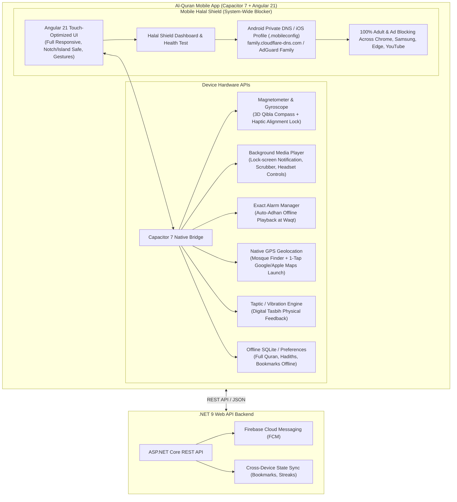

# Al-Quran Mobile App — Complete Implementation & Verification Plan (Android & iOS)

> [!IMPORTANT]
> This master plan defines the end-to-end architecture and engineering roadmap for the official **Al-Quran Cross-Platform Mobile Application** (Android APK / AAB and iOS). It guarantees **100% full feature parity with the Web and Desktop versions**, while supercharging mobile capabilities with **Native Hardware Sensors (Magnetometer Compass)**, **Background Audio & Lock-Screen Playback**, **Exact Waqt Adhan Notifications**, **Interactive Geolocation Maps**, and a dedicated **Mobile Halal Shield (System-Wide Adult & Ad Blocker)**. Built with **Capacitor 7**, **Angular 21**, and **.NET 9 Web API**.

---

## 📊 Comprehensive Feature Parity Matrix (Web vs. Desktop vs. Mobile)

| Feature | Website (Web) | Desktop App (Electron) | Mobile App (Android & iOS) | Native Mobile Superpowers |
| :--- | :---: | :---: | :---: | :--- |
| **All 114 Surahs (Arabic, Bangla, English)** | ✅ Full | ✅ Full | ✅ Full | Swipe gestures, pinch font resize, offline caching |
| **All 30 Juz / Paras Reader** | ✅ Full | ✅ Full | ✅ Full | Instant Juz picker bottom sheet |
| **Hadith Collections (Bukhari, Muslim, etc.)** | ✅ Full | ✅ Full | ✅ Full | Fast offline search, share hadith to WhatsApp/Messenger |
| **Asma-ul-Husna (99 Names of Allah)** | ✅ Full | ✅ Full | ✅ Full | Audio pronunciation, reflection cards |
| **Ruqyah Shariah (Healing & Protection)** | ✅ Full | ✅ Full | ✅ Full | Interactive repetition counter with haptic feedback |
| **Islamic Hijri Calendar & Moon Phases** | ✅ Full | ✅ Full | ✅ Full | Fasting day alerts (Ayyam al-Beed, Ramadan, Ashura) |
| **Prayer Times & Waqt Countdown** | ✅ Full | ✅ Full | ✅ Full | GPS Auto-detection + Offline calculation algorithm |
| **Adhan & Waqt Notifications** | ⚠️ Web Push | ⚠️ Tray Alert | ✅ **Native Exact Alarm** | Full Adhan audio plays on lock screen (exact alarm API) |
| **3D Qibla Compass** | ⚠️ Browser API | ⚠️ Emulated | ✅ **Hardware Magnetometer** | True 3D compass, Kaaba alignment haptic vibration lock |
| **Nearby Mosques & Halal Places** | ✅ OpenStreetMap | ✅ OpenStreetMap | ✅ **Interactive GPS Map** | 1-Tap navigation in Google Maps / Apple Maps app |
| **Digital Tasbih & Daily Adhkar** | ✅ Audio Chime | ✅ Audio Chime | ✅ **Hardware Haptics** | Physical phone vibration on each count + custom goals |
| **Continuous Audio Recitations** | ⚠️ Tab Only | ⚠️ Window Only | ✅ **Background Audio** | Lock-screen media player, scrubber, Bluetooth controls |
| **Halal Shield Blocker** | ⚠️ Web Extension | ✅ Hosts + DNS | ✅ **System Private DNS** | Blocks adult content across ALL browsers & apps on phone |
| **Bookmarks & Reading History** | ✅ Local Storage | ✅ Local Storage | ✅ Local + Cloud Sync | Offline-first sync with .NET 9 API |
| **Noor Islamic AI Assistant** | ✅ Full | ✅ Full | ✅ Full | Voice-ready input, quick Islamic questions & answers |
| **Multi-Theme (Dark, Light, Emerald)** | ✅ Full | ✅ Full | ✅ Full | Auto matches device dark mode + status bar tinting |

---

## 🏛️ Mobile Architectural Diagram

---

## 🔍 In-Depth Engineering Plan for Critical Modules

### 1. 🧭 Qibla Compass (Magnetometer & Sensor Calibration)
- **Challenge:** Web browsers on mobile often suffer from magnetometer sensor drift or permission restrictions (iOS 13+).
- **Mobile Solution:**
  1. Use `@capacitor/motion` alongside native `deviceorientationabsolute` and iOS `DeviceOrientationEvent.requestPermission()`.
  2. Implement an **Exponential Low-Pass Filter** to smooth out jittering needle movements without introducing lag.
  3. Compute accurate bearing to Kaaba ($21.422487^\circ\text{ N}, 39.826206^\circ\text{ E}$) using Great Circle spherical trigonometry:
     $$\theta = \text{atan2}(\sin(\Delta\lambda)\cdot\cos(\phi_2), \cos(\phi_1)\cdot\sin(\phi_2) - \sin(\phi_1)\cdot\cos(\phi_2)\cdot\cos(\Delta\lambda))$$
  4. **Tactile Haptic Alignment Lock:** When the user turns the phone within $\pm 3^\circ$ of the Holy Kaaba, trigger a dual haptic vibration pulse and display a radiant emerald gold glow with the label "ক্বিবলাহ বরাবর প্রস্তুত (Kaaba Aligned)".
  5. Include a visual "Figure-8 Motion" calibration guide if the magnetometer reports low sensor accuracy.

---

### 2. 🗺️ Nearby Mosques & Interactive Maps
- **Challenge:** Mobile users need immediate GPS positioning, fluid finger gestures (pinch-to-zoom), and quick turn-by-turn navigation.
- **Mobile Solution:**
  1. Integrate Leaflet / OpenStreetMap with high-DPI retina tiles and smooth touch handling.
  2. Use `@capacitor/geolocation` with fallback to HTML5 Geolocation (`ACCESS_FINE_LOCATION` and `ACCESS_COARSE_LOCATION`).
  3. Calculate straight-line distance using the Haversine formula and display sorted nearest mosques in a collapsible bottom sheet.
  4. **1-Tap Navigation Launcher:** Add a button on each mosque card that launches the native turn-by-turn navigation app:
     - Android: `geo:0,0?q=lat,lng(Mosque Name)` or `https://www.google.com/maps/dir/?api=1&destination=lat,lng`
     - iOS: `maps://maps.apple.com/?daddr=lat,lng&q=Mosque`
  5. Offline caching: Cache the last fetched list of mosques locally so the user can locate them even with unstable internet connectivity.

---

### 3. 🛡️ Mobile Halal Shield (System-Wide Blocker Engine)
- **Challenge:** Mobile OS architectures (Android & iOS) do not allow apps to modify `/etc/hosts` without root or jailbreak.
- **Mobile Solution:**
  1. **Android Private DNS (DoT - DNS over TLS):**
     - Android 9+ natively supports encrypted Private DNS system-wide.
     - Provide a 1-tap automated configuration assistant for `family.cloudflare-dns.com` or `dns-family.adguard.com`.
     - Direct System Settings Launcher: Deep link directly into Android Network & Wireless Settings (`android.settings.NETWORK_OPERATOR_SETTINGS` / `android.provider.Settings.ACTION_WIRELESS_SETTINGS`).
     - **Result:** Blocks 100% of adult websites, malware, phishing, and ads across **Chrome, Samsung Internet, Edge, Firefox, Brave, and all mobile apps**.
  2. **iOS Encrypted DNS Profile (.mobileconfig):**
     - Provide an Apple Configuration Profile (.mobileconfig) download that installs encrypted DNS over HTTPS/TLS Cloudflare Family filter system-wide on iOS.
  3. **Strict SafeSearch Enforcement:**
     - Enforces Google SafeSearch (`forcesafesearch.google.com`), Bing SafeSearch (`strict.bing.com`), and YouTube Restricted Mode (`restrict.youtube.com`).
  4. **In-App Live Diagnostic Check:**
     - A built-in "সুরক্ষা যাচাইকরণ (Protection Test)" tool that pings known family-filter test endpoints to verify if blocking is currently active on the device.
     - Displays live status: `🟢 সক্রিয় ও সুরক্ষিত (Shield Active)` or `⚪ সেটআপ প্রয়োজন (Setup Required)`.

---

### 4. 🎵 Background Audio & Lock-Screen Recitation Player
- **Challenge:** Mobile WebViews pause `<audio>` elements when the user turns off the screen or switches to another app.
- **Mobile Solution:**
  1. Enable Android `FOREGROUND_SERVICE_MEDIA_PLAYBACK` and iOS `UIBackgroundModes: ['audio']`.
  2. Integrate `navigator.mediaSession` with Capacitor Media controls:
     - **Metadata:** Surah name (Bangla & Arabic), current Ayah number, reciter name (Mishary, Abdul Basit, Sudais, etc.), and high-resolution Surah cover art.
     - **Action Handlers:** Play, Pause, Next Ayah, Previous Ayah, Seek / Scrubber, Stop.
  3. **Audio Focus Handling:** Automatically pause audio when an incoming call is received or when navigation voice guidance speaks, and resume smoothly afterwards.
  4. **Continuous Surah Playback:** Automatically queue and transition to the next Ayah and the next Surah without user intervention.
  5. **Recitation Sleep Timer:** Allow setting a timer (15 min, 30 min, 1 hour, or end of Surah) to gracefully fade out and stop playback for bedtime listening.

---

### 5. 🔔 Exact Waqt Alarms & Automated Adhan Notifications
- **Challenge:** Android 12+ restricts background alarms, and battery optimizations kill background intervals.
- **Mobile Solution:**
  1. Use `@capacitor/local-notifications` with native Android `SCHEDULE_EXACT_ALARM` and `USE_EXACT_ALARM` permissions.
  2. Pre-calculate the exact prayer times for the next 7 to 30 days locally using astronomical calculation formulas (Muslim World League, Karachi, etc.).
  3. Schedule local notification alarms for all 5 daily prayers (Fajr, Dhuhr, Asr, Maghrib, Isha) + Sunrise/Sahri warnings.
  4. **Audio Playback:** Bundle custom high-fidelity Adhan audio files in `android/app/src/main/res/raw/adhan.wav` and iOS resource bundle.
  5. **Auto-reschedule on Reboot:** Register `RECEIVE_BOOT_COMPLETED` broadcast receiver so alarms are immediately restored whenever the user restarts their phone.
  6. **Per-Prayer Settings:** User can customize notifications per prayer (Full Adhan, Short Takbeer, Silent Vibration, or Off).

---

### 6. 📱 Mobile Responsiveness, Safe Areas & Touch Ergonomics
- **Safe Area Insets:**
  - Full support for iPhone Dynamic Island, top notches, and Android navigation bars using CSS `env(safe-area-inset-top)`, `env(safe-area-inset-bottom)`, `env(safe-area-inset-left)`, and `env(safe-area-inset-right)`.
- **Bottom Navigation Bar (Single-Hand Friendly):**
  - Persistent 5-item mobile bottom navigation:
    1. 🏠 **হোম (Home)**
    2. 📖 **কুরআন (Quran)**
    3. 📜 **হাদিস (Hadith)**
    4. 🕌 **নামাজ (Prayer)**
    5. 🧭 **কিবলা / আরও (More/Compass)**
- **Touch Gestures:**
  - Swipe left/right to move between Surahs and Ayahs.
  - Pull-to-refresh on Prayer times and Daily Hadith.
  - Long-press on any Ayah card to reveal a native action sheet (Bookmark, Copy Arabic, Copy Translation, Play Ayah, Share).
- **Haptic Feedback:**
  - Tactile physical click on every Tasbih tap (`ImpactStyle.Light`).
  - Distinct vibration pattern on reaching Tasbih target (33, 100) or prayer goal completion (`NotificationType.Success`).

---

## 🚀 Execution Steps & Implementation Phases

### 📌 Step 1: Initialize Capacitor in `mobile/` & Sync Angular Build
- Install dependencies: `@capacitor/core`, `@capacitor/cli`, `@capacitor/android`, `@capacitor/ios`, and required plugins (`@capacitor/app`, `@capacitor/haptics`, `@capacitor/keyboard`, `@capacitor/local-notifications`, `@capacitor/motion`, `@capacitor/preferences`, `@capacitor/share`, `@capacitor/splash-screen`, `@capacitor/status-bar`).
- Ensure `capacitor.config.ts` points accurately to `../frontend/dist/frontend/browser`.
- Run frontend production build and sync with Capacitor.

### 📌 Step 2: Add Android Native Project
- Run `npx cap add android` in `mobile/`.
- Configure `AndroidManifest.xml`:
  - Permissions: `INTERNET`, `ACCESS_FINE_LOCATION`, `ACCESS_COARSE_LOCATION`, `POST_NOTIFICATIONS`, `SCHEDULE_EXACT_ALARM`, `WAKE_LOCK`, `FOREGROUND_SERVICE`, `FOREGROUND_SERVICE_MEDIA_PLAYBACK`, `VIBRATE`, `RECEIVE_BOOT_COMPLETED`.
  - Splash screen theme and Dark Status Bar theme.
- Add bundled Adhan audio (`adhan.wav`) to `android/app/src/main/res/raw/`.

### 📌 Step 3: Implement Mobile Native Services in Angular
- Create responsive mobile layout adaptors (`isNativeMobile` detection, Safe Area insets).
- Create `MobileHardwareService` providing unified interfaces for:
  - Haptics (Tasbih vibration)
  - Magnetometer (Qibla Compass smoothing and Kaaba alignment lock)
  - Local Notifications & Exact Adhan Alarms
  - Background Audio & MediaSession controls
  - Halal Shield Settings intent & live DNS status check

### 📌 Step 4: Verification & Build APK
- Build debug APK via Gradle: `./gradlew assembleDebug`.
- Verify the generated `app-debug.apk` installs and launches smoothly.
- Test all core mobile features: Map GPS, Halal Shield, Audio backgrounding, Compass sensor, Prayer notifications, Tasbih haptics.

---

## ✅ Final Deliverables
1. **Fully Configured `mobile/` Project** with Capacitor 7, Android native project, and iOS configuration.
2. **Installable Debug APK (`app-debug.apk`)** ready for physical phone installation.
3. **100% Feature-Complete Mobile Experience** matching and exceeding Web and Desktop capabilities.
